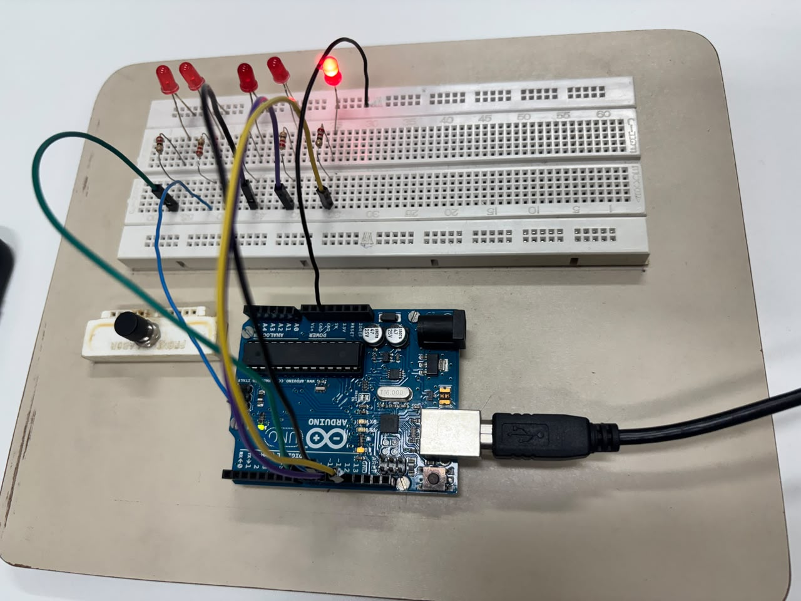
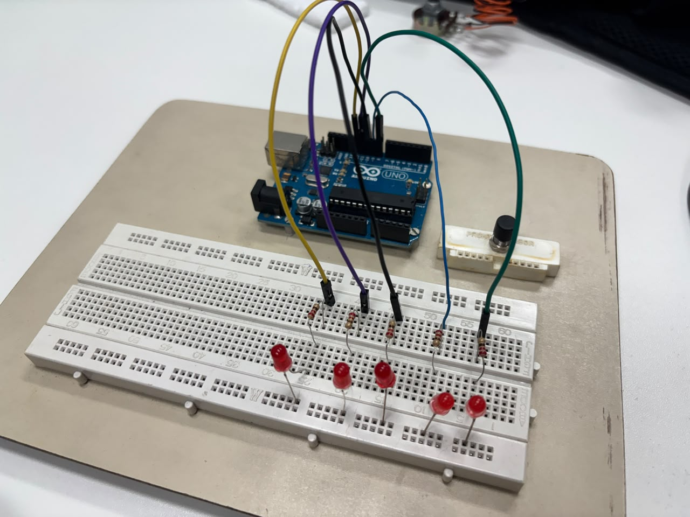
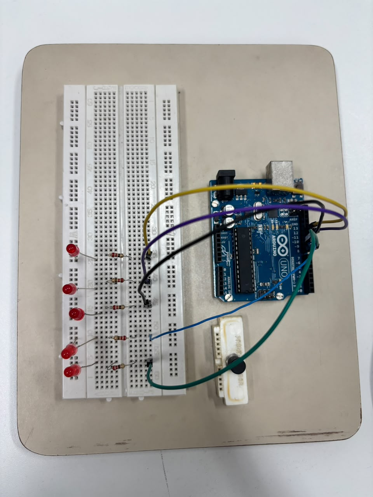

# Acionamento sequencial de LEDs com Arduino Uno

> Projeto da faculdade: disciplina **Sistemas Digitais e Microprocessadores**, Ciência da Computação (Anhanguera, 2026).

## Resumo

O que faz: um Arduino Uno R3 acende **5 LEDs, um de cada vez, em sequência**. Cada LED fica aceso por 200 ms, e quando o último apaga o ciclo recomeça.

| | |
|---|---|
| **Linguagem** | C++ (linguagem do Arduino) |
| **Ferramenta** | Arduino IDE |
| **Placa** | Arduino Uno R3 |
| **Código** | [`leds_sequenciais/leds_sequenciais.ino`](leds_sequenciais/leds_sequenciais.ino) |



🎥 [Vídeo do circuito funcionando](fotos/demonstracao.mp4)

## Para que serve cada peça

| Peça | Qtd. | Função |
|---|---|---|
| Arduino Uno R3 | 1 | Microcontrolador que roda o código e liga e desliga os LEDs |
| Protoboard | 1 | Placa para montar o circuito sem solda |
| LED vermelho 5 mm | 5 | Saídas visuais da sequência |
| Resistor 220 Ω | 5 | Limita a corrente de cada LED para não queimá-lo |
| Jumpers | — | Fios que ligam o Arduino à protoboard |
| Cabo USB | 1 | Alimenta a placa e envia o código do computador |

Ligação: cada LED, em série com o seu resistor, vai a um pino digital do Arduino, do **D8 ao D12**.

## Como o código funciona

```cpp
const byte leds[5] = {8, 9, 10, 11, 12};   // pinos dos 5 LEDs
const unsigned long tempoAceso = 200;      // tempo de cada LED (ms)
```

- **`setup()`**: roda uma vez ao ligar. Configura os pinos 8 a 12 como saída e começa com todos os LEDs apagados.
- **`loop()`**: repete sem parar. Acende um LED, espera 200 ms, apaga e passa para o próximo.

Para deixar a sequência mais rápida ou mais lenta, mude o valor de `tempoAceso`.

## Como rodar

1. Abra `leds_sequenciais/leds_sequenciais.ino` na Arduino IDE.
2. Escolha a placa **Arduino Uno** e a porta COM.
3. Clique em **Upload**.

## Fotos

| | |
|---|---|
|  |  |

## Equipe

Matheus Gomes, Arthur Ferreira do Prado e Renan Garcia da Silva.
